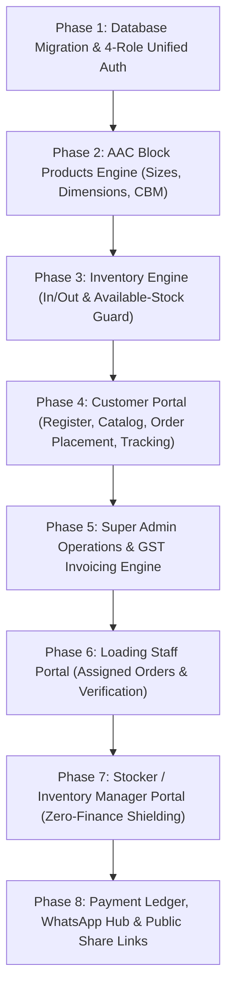

# Swarnim AAC Block PWA — 1:1 Demo Recreation Master Plan

> **Objective:** Recreate the **exact functional architecture, 4-role permission model, order-to-dispatch lifecycle, GST invoicing engine, and inventory workflows** from `accblock-Demo` (V6) into the modern `pwa` codebase (Next.js 15, Prisma, PostgreSQL, TypeScript, Tailwind CSS, PWA).

---

## 🏛️ Exact 1-to-1 Mapping: Demo vs PWA

| Demo Feature (`accblock-Demo`) | PWA Target (`pwa`) |
| :--- | :--- |
| **4 Login Roles** (Customer, Staff, Stocker, Super Admin) | Unified Auth with 4 Roles: `CUSTOMER`, `STAFF`, `STOCKER`, `ADMIN` in Prisma + Role Gate Middleware |
| **Landing & Role Login** (`index.php`, `login.php`, `register.php`) | Modern PWA landing page with 4 role quick-select tabs + Customer Self-Registration |
| **Customer Portal** (`customer/` 6 screens) | `/customer/dashboard`, `/customer/orders`, `/customer/new-order`, `/customer/invoices`, `/customer/profile` |
| **Loading Staff Portal** (`staff/` 2 screens) | `/staff/dashboard`, `/staff/loading/[id]` (Mobile-optimized loading verification; **Strictly NO financial data**) |
| **Stocker Portal** (`stocker/` 6 screens) | `/stocker/dashboard`, `/stocker/stock`, `/stocker/orders`, `/stocker/products`, `/stocker/activity` (**Strictly NO prices/payments**) |
| **Super Admin Portal** (`admin/` 8 screens) | `/admin/dashboard`, `/admin/orders/[id]`, `/admin/products`, `/admin/stock`, `/admin/payments`, `/admin/users`, `/admin/activity` |
| **AAC Block Specifications** (`products` table) | $L \times H \times W$ (mm), auto-calculated CBM/block, Blocks/CBM, Rate, GST 18%, Active toggle |
| **Full Order Lifecycle** (`orders` table) | `PENDING` ➔ `CONFIRMED` ➔ `ASSIGNED` ➔ `LOADING` ➔ `LOADED` ➔ `DISPATCHED` ➔ `DELIVERED` |
| **GST Tax Invoice** (`invoice.php`) | Full printable Tax Invoice with CGST (9%) + SGST (9%), Print/PDF button, compliant layout |
| **Public Invoice Sharing** (`invoice-share.php`) | `/invoice/share/[token]` public route (opens on customer phone without requiring login) |
| **Payment Ledger** (`payments` table) | Partial/full payments (Bank, UPI, Cash, Cheque), auto balance recalculation (`pending`, `partial`, `paid`) |
| **Stock Protection** (`stock_movements`) | Manual Stock In/Out + Auto Out on dispatch; **strictly blocked if stock is insufficient** |
| **WhatsApp Hub** (`whatsapp.php`, `message_logs`) | One-click WhatsApp buttons with dynamic messages for all 8 milestones + message logging |

---

## 🗄️ Database Architecture (`prisma/schema.prisma`)

```prisma
datasource db {
  provider = "postgresql"
  url      = env("DATABASE_URL")
}

generator client {
  provider = "prisma-client-js"
}

enum Role {
  CUSTOMER
  STAFF
  STOCKER
  ADMIN
}

enum OrderStatus {
  PENDING
  CONFIRMED
  ASSIGNED
  LOADING
  LOADED
  DISPATCHED
  DELIVERED
  CANCELLED
  REJECTED
}

enum PaymentStatus {
  PENDING
  PARTIAL
  PAID
}

enum PaymentMode {
  BANK_TRANSFER
  UPI
  CASH
  CHEQUE
}

enum StockType {
  IN
  OUT
}

model User {
  id              String          @id @default(cuid())
  role            Role            @default(CUSTOMER)
  name            String
  mobile          String          @unique
  email           String          @unique
  passwordHash    String
  companyName     String?
  gstin           String?
  billingAddress  String?
  deliveryAddress String?
  city            String?
  state           String?         @default("Gujarat")
  pincode         String?
  active          Boolean         @default(true)
  createdAt       DateTime        @default(now())
  updatedAt       DateTime        @updatedAt

  customerOrders  Order[]         @relation("CustomerOrders")
  assignedOrders  Order[]         @relation("StaffAssignedOrders")
  stockMovements  StockMovement[]
  paymentsCreated Payment[]
  orderEvents     OrderEvent[]
  messageLogs     MessageLog[]

  @@index([role])
  @@index([mobile])
}

model Product {
  id           String          @id @default(cuid())
  name         String          @default("AAC Block")
  sizeLabel    String          // e.g. "4 Inch", "6 Inch", "8 Inch", "9 Inch"
  dimensions   String          // e.g. "600 × 200 × 100 mm"
  lengthMm     Int             @default(600)
  heightMm     Int             @default(200)
  widthMm      Int             // 75, 100, 125, 150, 175, 200, 225, 230, 300
  cbmPerBlock  Decimal         @db.Decimal(10, 4) // (L * H * W) / 1,000,000,000
  blocksPerCbm Decimal         @db.Decimal(10, 2) // 1 / cbmPerBlock
  price        Decimal         @default(0) @db.Decimal(12, 2)
  gstRate      Decimal         @default(18.00) @db.Decimal(5, 2)
  active       Boolean         @default(true)
  createdAt    DateTime        @default(now())
  updatedAt    DateTime        @updatedAt

  orders       Order[]
  movements    StockMovement[]

  @@index([sizeLabel])
  @@index([active])
}

model Order {
  id              String          @id @default(cuid())
  orderNo         String          @unique // e.g. "ORD-2026-1001"
  customerId      String
  customer        User            @relation("CustomerOrders", fields: [customerId], references: [id])
  productId       String
  product         Product         @relation(fields: [productId], references: [id])
  quantity        Int
  loadedQuantity  Int             @default(0)
  rate            Decimal         @db.Decimal(12, 2)
  gstRate         Decimal         @default(18.00) @db.Decimal(5, 2)
  subtotal        Decimal         @db.Decimal(14, 2)
  gstAmount       Decimal         @db.Decimal(14, 2)
  totalAmount     Decimal         @db.Decimal(14, 2)
  deliveryAddress String
  requestedDate   DateTime?
  notes           String?
  status          OrderStatus     @default(PENDING)
  invoiceNo       String?         @unique // e.g. "INV-2026-0001"
  shareToken      String?         @unique // Secure public token for WhatsApp
  paymentStatus   PaymentStatus   @default(PENDING)
  paidAmount      Decimal         @default(0) @db.Decimal(14, 2)
  
  assignedStaffId String?
  assignedStaff   User?           @relation("StaffAssignedOrders", fields: [assignedStaffId], references: [id])

  confirmedAt     DateTime?
  dispatchedAt    DateTime?
  deliveredAt     DateTime?
  createdAt       DateTime        @default(now())
  updatedAt       DateTime        @updatedAt

  transport       Transport?
  events          OrderEvent[]
  payments        Payment[]
  movements       StockMovement[]
  messageLogs     MessageLog[]

  @@index([status])
  @@index([customerId])
  @@index([assignedStaffId])
}

model Transport {
  id               String    @id @default(cuid())
  orderId          String    @unique
  order            Order     @relation(fields: [orderId], references: [id], onDelete: Cascade)
  transporterName  String?
  truckNumber      String
  driverName       String
  driverMobile     String
  expectedDelivery DateTime?
  assignedAt       DateTime  @default(now())
}

model OrderEvent {
  id        String      @id @default(cuid())
  orderId   String
  order     Order       @relation(fields: [orderId], references: [id], onDelete: Cascade)
  status    OrderStatus
  title     String
  note      String?
  createdById String?
  createdBy User?       @relation(fields: [createdById], references: [id], onDelete: SetNull)
  createdAt DateTime    @default(now())

  @@index([orderId])
  @@index([createdAt])
}

model Payment {
  id          String      @id @default(cuid())
  orderId     String
  order       Order       @relation(fields: [orderId], references: [id], onDelete: Cascade)
  amount      Decimal     @db.Decimal(14, 2)
  mode        PaymentMode
  referenceNo String?
  paidAt      DateTime    @default(now())
  createdById String?
  createdBy   User?       @relation(fields: [createdById], references: [id], onDelete: SetNull)
  createdAt   DateTime    @default(now())

  @@index([orderId])
}

model StockMovement {
  id            String    @id @default(cuid())
  productId     String
  product       Product   @relation(fields: [productId], references: [id])
  orderId       String?
  order         Order?    @relation(fields: [orderId], references: [id], onDelete: SetNull)
  type          StockType // IN or OUT
  quantityDelta Int       // Positive for IN, Negative for OUT
  referenceNo   String?
  note          String?
  createdById   String?
  createdBy     User?     @relation(fields: [createdById], references: [id], onDelete: SetNull)
  createdAt     DateTime  @default(now())

  @@index([productId])
  @@index([type])
  @@index([createdAt])
}

model MessageLog {
  id          String    @id @default(cuid())
  orderId     String
  order       Order     @relation(fields: [orderId], references: [id], onDelete: Cascade)
  messageType String    // invoice, confirmed, assigned, loading, loaded, dispatched, delivered, payment
  mobile      String
  messageText String
  createdById String?
  createdBy   User?     @relation(fields: [createdById], references: [id], onDelete: SetNull)
  createdAt   DateTime  @default(now())

  @@index([orderId])
}
```

---

## 🗺️ Step-by-Step Execution Plan



---

### Phase 1: Database Migration & 4-Role Unified Auth
* **Goal:** Implement the complete schema in `prisma/schema.prisma` and establish seamless 4-role authentication matching `accblock-Demo`.
* **Deliverables:**
  1. Push updated Prisma schema to PostgreSQL (`npx prisma db push`).
  2. Seed default demo accounts matching the demo:
     - **Super Admin:** `admin@swarnimdemo.com` / `Admin@123`
     - **Loading Staff:** `loader@swarnimdemo.com` / `Loader@123`
     - **Stocker:** `stocker@swarnimdemo.com` / `Stocker@123`
     - **Customer:** `customer@swarnimdemo.com` / `Customer@123`
  3. Universal 4-Role Login Page (`/login`) with tab buttons for Customer, Staff, Stocker, Admin.
  4. Customer Registration Page (`/register`) with Company Name, GSTIN, and Delivery Site Address.
  5. Route Protection Middleware: Automatically routes users to their role-specific home (`/customer`, `/staff`, `/stocker`, or `/admin`).

---

### Phase 2: AAC Block Products Engine (Sizes, Dimensions, CBM)
* **Goal:** Port the 9 industry-standard AAC block sizes and automatic CBM calculations.
* **Standard Reference Sizes:**
  1. `3 Inch` (600 × 200 × 75 mm) — 0.0090 CBM/block (111.11 blocks/CBM)
  2. `4 Inch` (600 × 200 × 100 mm) — 0.0120 CBM/block (83.33 blocks/CBM)
  3. `5 Inch` (600 × 200 × 125 mm) — 0.0150 CBM/block (66.67 blocks/CBM)
  4. `6 Inch` (600 × 200 × 150 mm) — 0.0180 CBM/block (55.56 blocks/CBM)
  5. `7 Inch` (600 × 200 × 175 mm) — 0.0210 CBM/block (47.62 blocks/CBM)
  6. `8 Inch` (600 × 200 × 200 mm) — 0.0240 CBM/block (41.67 blocks/CBM)
  7. `9 Inch` (600 × 200 × 225 mm) — 0.0270 CBM/block (37.04 blocks/CBM)
  8. `9+ Inch` (600 × 200 × 230 mm) — 0.0276 CBM/block (36.23 blocks/CBM)
  9. `12 Inch` (600 × 200 × 300 mm) — 0.0360 CBM/block (27.78 blocks/CBM)
* **Formulas:**
  $$\text{CBM} = \frac{L \times H \times W}{1,000,000,000}, \quad \text{Blocks per CBM} = \frac{1}{\text{CBM}}$$
* **Deliverables:**
  - Complete `/admin/products` module for Super Admin: Edit dimensions, set selling rates, set GST rates, activate/deactivate.
  - Complete `/stocker/products` module for Stocker: Edit dimensions and add new sizes (prices fixed at 0 and inactive).

---

### Phase 3: Inventory Engine (In/Out & Available-Stock Guard)
* **Goal:** Recreate the inventory system with real-time size-wise balances and strict protection against negative stock.
* **Deliverables:**
  - Manual Stock In (production receipt, batch challan).
  - Manual Stock Out (damage, sample, site issue) — **blocked if entered quantity > current available stock**.
  - Live Stock Summary cards with low-stock warnings (< 500 blocks).
  - Full movement audit log (Date, Block Size, Qty Delta, Movement Type, Reference, User, Notes).

---

### Phase 4: Customer Portal
* **Goal:** Replicate the 6 customer screens from `accblock-Demo/customer/`.
* **Deliverables:**
  1. `/customer/dashboard`: Active block sizes with rates, recent orders, unpaid balance alert.
  2. `/customer/new-order`: Select block size, auto-calculates Subtotal + 18% GST + Grand Total, delivery address, site instructions.
  3. `/customer/orders`: Order history filterable by status.
  4. `/customer/orders/[id]`: Live tracking timeline, assigned truck and driver details, payment breakdown.
  5. `/customer/invoices`: View and print all generated GST invoices.
  6. `/customer/profile`: Update Company Name, GSTIN, and default delivery address.

---

### Phase 5: Super Admin Operations & GST Invoicing Engine
* **Goal:** Replicate the full admin operations console from `accblock-Demo/admin/`.
* **Deliverables:**
  1. `/admin/dashboard`: Financial & operational overview (Stock, Revenue, Active Orders, Dispatches, Receivables).
  2. `/admin/orders/[id]`:
     - **Confirm Order:** Adjust final quantity & rate ➔ generate `INV-YYYY-XXXX` invoice + secure share token.
     - **Reject Order:** With optional rejection reason.
     - **Assign Transport:** Select loading staff, transporter name, truck number, driver name, mobile, and ETA.
     - **Dispatch Order:** Validates stock $\ge$ loaded quantity ➔ creates automatic `OUT` stock movement.
     - **Mark Delivered:** Material received at customer site.
  3. **GST Tax Invoice:** Formal printable Tax Invoice (`/invoice/[id]`) with CGST (9%) + SGST (9%), company GSTIN, print styles.
  4. **Public Share Link:** `/invoice/share/[token]` accessible directly from WhatsApp without logging in.

---

### Phase 6: Loading Staff Portal (Yard Verification)
* **Goal:** Replicate `accblock-Demo/staff/` for yard mobile screens.
* **Deliverables:**
  1. `/staff/dashboard`: List of assigned loading orders (Truck number, block size, quantity).
  2. `/staff/orders/[id]`:
     - Tap **"Start Loading"** ➔ moves order to `LOADING` status.
     - Enter actual counted **"Loaded Quantity"** ➔ tap **"Mark Loading Done"** ➔ moves to `LOADED`.
  3. **Security Guard:** Zero financial data (no rates, GST, invoice totals, or payment status).

---

### Phase 7: Stocker / Inventory Manager Portal (Zero-Finance Shielding)
* **Goal:** Replicate `accblock-Demo/stocker/` with full operational visibility and strict financial masking.
* **Deliverables:**
  1. `/stocker/dashboard`: Inventory totals, active orders, recent movements. No revenue metrics.
  2. `/stocker/orders`: Operational order tracker (Customer, size, quantity, transport, status timeline). No rates or prices.
  3. `/stocker/stock`: Stock In / Stock Out with available-stock protection.
  4. `/stocker/products`: Dimension and size manager.
  5. **Security Guard:** Automatically hides prices, rates, totals, and payment events from all Stocker views.

---

### Phase 8: Payment Ledger, WhatsApp Hub & Public Share Links
* **Goal:** Replicate payments and customer communications.
* **Deliverables:**
  1. **Payments System:** Record payments (Bank, UPI, Cash, Cheque) on `/admin/orders/[id]`. Auto-recalculates order payment status (`PENDING`, `PARTIAL`, `PAID`) and balance due.
  2. `/admin/payments`: Central payments ledger.
  3. **WhatsApp Engine:** One-click WhatsApp buttons for all 8 milestones with phone number formatting and message logging in `MessageLog`.

---

## 🚀 Execution Order

We will execute this roadmap step by step:

1. **Step 1:** Update `prisma/schema.prisma` with the complete model and run `npx prisma db push`.
2. **Step 2:** Update `prisma/seed.ts` with the 4 demo accounts (Customer, Staff, Stocker, Admin) and the 9 reference AAC block sizes.
3. **Step 3:** Implement Unified 4-Role Authentication (`/login`, `/register`, role middleware).
4. **Step 4:** Build the Super Admin & Stocker Products and Inventory Modules.
5. **Step 5:** Build the Customer Portal (Catalog, New Order, Order Tracking, Profile).
6. **Step 6:** Build the Loading Staff Portal (Assigned Tasks & Loaded Count).
7. **Step 7:** Build the Admin Order Management, GST Invoicing & Payment Engine.
8. **Step 8:** Add WhatsApp Integration & Public Invoice Sharing.
